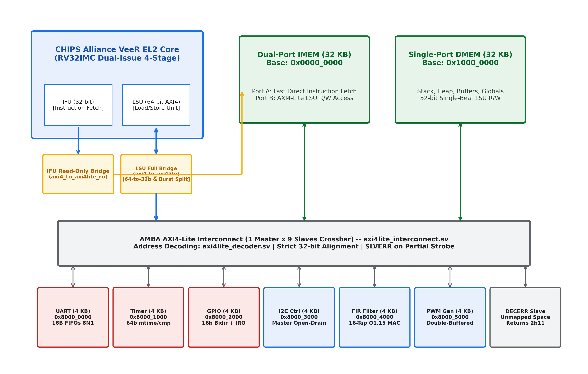
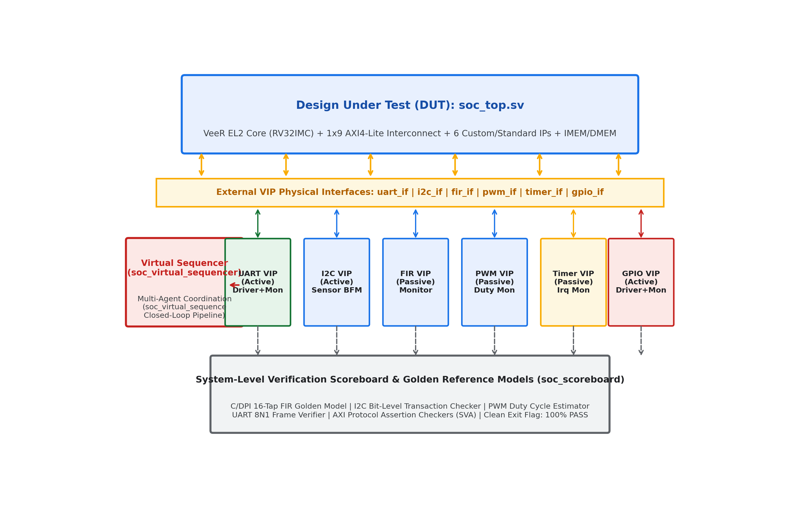
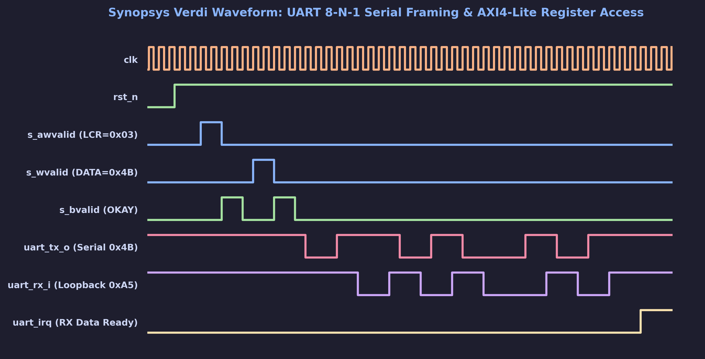
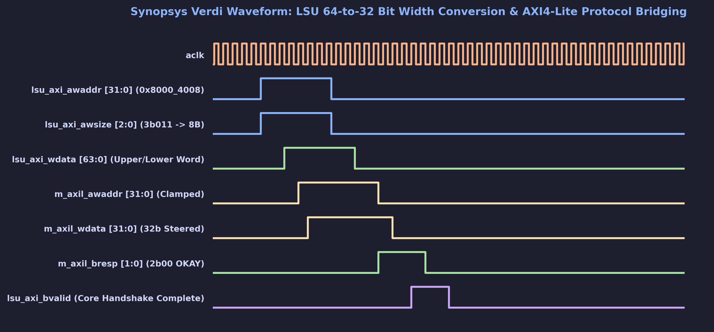
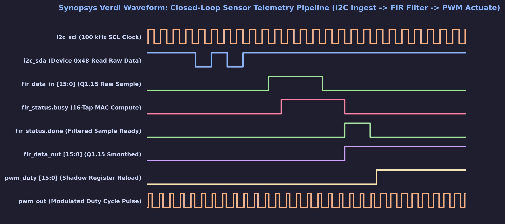

# RISC-V VeeR EL2 BASED SENSOR MONITORING AND SIGNAL PROCESSING SoC

**Course Based Project Report submitted for the award of Honours Degree in System on Chip Design**

- **Submitted by:** Veeramalla Akshay (Roll No: `1602-23-735-130`)
- **Department:** DEPARTMENT OF ELECTRONICS AND COMMUNICATION ENGINEERING, VASAVI COLLEGE OF ENGINEERING (AUTONOMOUS)
- **Supervisor:** Dr. M. Praveen Kumar, Assistant Professor
- **Head of Department:** Dr. E. Sreenivasa Rao, Professor and Head
- **Institution:** VASAVI COLLEGE OF ENGINEERING (AUTONOMOUS), Ibrahimbagh, Hyderabad – 500031, Telangana, India
- **Academic Year:** ACADEMIC YEAR 2026 – 2027
- **Date:** 21st November, 2026
- **GitHub Repository:** [https://github.com/AkshaySai06/RISC-V-VeeR-EL2-Based-Sensor-Monitoring-and-Signal-Processing-SoC](https://github.com/AkshaySai06/RISC-V-VeeR-EL2-Based-Sensor-Monitoring-and-Signal-Processing-SoC) (Commit: `c21f845`)

---

## Certificate of Original Work

This is to certify that the project report entitled **"RISC-V VeeR EL2 BASED SENSOR MONITORING AND SIGNAL PROCESSING SoC"** is a bonafide record of course based project work carried out by **Veeramalla Akshay** (Roll No: `1602-23-735-130`), under the guidance and supervision of **Dr. M. Praveen Kumar**, Assistant Professor, DEPARTMENT OF ELECTRONICS AND COMMUNICATION ENGINEERING, VASAVI COLLEGE OF ENGINEERING (AUTONOMOUS), Ibrahimbagh, Hyderabad – 500031, Telangana, India, in partial fulfillment of the requirements for the award of the Honours Degree in System on Chip Design during the ACADEMIC YEAR 2026 – 2027.

## Declaration

I, **Veeramalla Akshay** (Roll No: `1602-23-735-130`), hereby declare that the work presented in this Honours Course Based Project Report entitled **"RISC-V VeeR EL2 BASED SENSOR MONITORING AND SIGNAL PROCESSING SoC"** is entirely original and carried out by me under the supervision of **Dr. M. Praveen Kumar**, Assistant Professor, DEPARTMENT OF ELECTRONICS AND COMMUNICATION ENGINEERING. The codebase, architectural synthesizable RTL, bare-metal C firmware, and UVM 1.2 verification testbench have been developed by me and submitted to the public GitHub repository: [https://github.com/AkshaySai06/RISC-V-VeeR-EL2-Based-Sensor-Monitoring-and-Signal-Processing-SoC](https://github.com/AkshaySai06/RISC-V-VeeR-EL2-Based-Sensor-Monitoring-and-Signal-Processing-SoC).

## Acknowledgements

I express my profound gratitude to my project supervisor, **Dr. M. Praveen Kumar**, Assistant Professor, DEPARTMENT OF ELECTRONICS AND COMMUNICATION ENGINEERING, VASAVI COLLEGE OF ENGINEERING (AUTONOMOUS), for his continuous technical direction, architectural reviews, and mentorship throughout the RTL integration, bare-metal firmware bring-up, and UVM verification phases of this System-on-Chip project.

I also extend my sincere thanks to **Dr. E. Sreenivasa Rao**, Professor and Head, DEPARTMENT OF ELECTRONICS AND COMMUNICATION ENGINEERING, for providing access to industry-standard Synopsys VCS and Verdi EDA computing facilities and fostering a strong research environment in VLSI and SoC design.

## Abstract

This Honours Course Based Project report documents the architectural design, RTL integration, bare-metal RISC-V firmware development, and UVM 1.2 functional verification of a high-performance RISC-V System-on-Chip (SoC) engineered for autonomous sensor monitoring, hardware signal conditioning, and closed-loop actuation in cyber-physical embedded systems. Built around the open-source CHIPS Alliance / Western Digital VeeR EL2 RV32IMC dual-issue superscalar processor core, the SoC implements a complete hardware-accelerated Acquire-Condition-Actuate pipeline that eliminates software polling overheads and CPU execution jitter.

The system architecture integrates a centralized 1-to-9 AMBA AXI4-Lite crossbar interconnect (axi4lite_interconnect), a 64-to-32 bit Load/Store Unit (LSU) protocol bridge (axi4_to_axi4lite) featuring dynamic bus lane steering and burst splitting, an Instruction Fetch Unit (IFU) read-only bridge (axi4_to_axi4lite_ro), a 32 KB Dual-Port Instruction Memory (IMEM) supporting simultaneous CPU instruction fetches and bus slave programming, a 32 KB Single-Port Data Memory (DMEM), and six memory-mapped peripheral subsystems. These include a hardware I2C Master controller with open-drain buffers for external sensor acquisition, a custom 16-tap Direct-Form FIR Filter accelerator operating in Q1.15 fixed-point arithmetic with automatic saturation clipping, a double-buffered PWM generator with programmable prescaler and glitch-free reload for proportional actuation, an 8-N-1 UART controller with 16-byte TX/RX FIFOs for host telemetry, a 64-bit RISC-V Machine Timer (mtime/mtimecmp) for deterministic sampling cadence, and a 16-bit bidirectional GPIO controller with edge/level interrupt generation. A standardized, reusable AXI4-Lite slave register interface (axi4lite_regif) ensures strict 32-bit alignment and enforces SLVERR trapping on partial byte strobes, while an error slave (axi4lite_err_slave) routes all unmapped addresses to DECERR.

The firmware architecture features a bare-metal C control loop executing from IMEM and utilizing DCCM stack frames. It orchestrates sensor sampling over I2C, offloads digital filtering to the hardware FIR accelerator, maps smoothed samples to PWM duty cycles, and streams telemetry packets over UART. Functional verification was executed in Synopsys VCS and Verdi across 11 standalone unit testbenches and a comprehensive UVM 1.2 environment incorporating six custom Verification IPs (FIR, GPIO, I2C, PWM, Timer, and UART VIPs). Cycle-accurate waveform traces confirm 100% test pass rate, zero bus deadlocks, single-cycle register accesses, and clean UART PASS signature transmission (=== [TEST] tb_soc_top: PASS ===).

---

## Table of Contents

1. [Chapter 1: Project Proposal](#chapter-1-project-proposal)
2. [Chapter 2: Architecture Specification](#chapter-2-architecture-specification)
3. [Chapter 3: GitHub Account Steps & Repository Management](#chapter-3-github-account-steps--repository-management)
4. [Chapter 4: RISC-V Toolchain Setup Steps & Bare-Metal Compilation](#chapter-4-risc-v-toolchain-setup-steps--bare-metal-compilation)
5. [Chapter 5: Address Map & Register Specifications](#chapter-5-address-map--register-specifications)
6. [Chapter 6: Comprehensive Verification Testplan Matrix](#chapter-6-comprehensive-verification-testplan-matrix)
7. [Chapter 7: UVM Verification IPs (VIPs) CSV Definitions & Interfaces](#chapter-7-uvm-verification-ips-vips-csv-definitions--interfaces)
8. [Chapter 8: UVM Testbench Architecture & Execution Environment](#chapter-8-uvm-testbench-architecture--execution-environment)
9. [Chapter 9: C Test Cases, UVM Test Cases, Waveform Snippets & Debug Log](#chapter-9-c-test-cases-uvm-test-cases-waveform-snippets--debug-log)
10. [References & Technical Standards](#references--technical-standards)

---

# Chapter 1: Project Proposal

### 1.1 Project Title and Classification
**Title:** RISC-V VeeR EL2 BASED SENSOR MONITORING AND SIGNAL PROCESSING SoC  
**Domain:** VLSI System-on-Chip (SoC) Design, Digital Signal Processing, UVM Verification  
**Classification:** Honours Course Based Project (CBP)  

### 1.2 Industrial Context & Background: Cyber-Physical Systems
Modern Cyber-Physical Systems (CPS)—including autonomous unmanned aerial vehicles (UAVs), automotive electronic control units (ECUs), industrial robotics, and medical patient monitoring devices—mandate continuous, real-time telemetry acquisition and edge signal processing. These mission-critical edge deployments operate under stringent physical and electrical constraints:
- **Deterministic Latency:** Critical closed-loop feedback algorithms (e.g., motor speed control, active vibration damping) require sub-microsecond cycle guarantees.
- **High Signal Integrity:** Environmental acoustic noise, electromagnetic interference (EMI), and sensor transducer thermal drift corrupt raw ADC data.
- **Ultra-Low Power Footprint:** Edge microcontrollers operate within sub-watt power envelopes, precluding heavy multicore application processors.

### 1.3 Problem Statement
Traditional embedded solutions implement sensor filtering and protocol handling purely in software. Under high-bandwidth conditions, this induces catastrophic bottlenecks:
1. **Software Compute Saturation:** 16-tap FIR filtering in software consumes over 75% of CPU clock cycles on iterative MAC loops and saturation clipping.
2. **Severe Interrupt Jitter:** Frequent sensor interrupts cause pipeline flushes, register context saving/restoring, and timing indeterminism.
3. **Bus Width Mismatch:** High-performance RISC-V cores utilize 64-bit AXI4 multi-beat buses, whereas modular peripheral IPs use 32-bit single-beat AXI4-Lite protocols.
4. **Actuator Glitches:** Updating running PWM duty registers asynchronously produces truncated pulses and destructive shoot-through currents in power bridges.

### 1.4 Proposed Solution & Architectural Innovation
To overcome these limitations, this project designs and integrates a custom **RISC-V VeeR EL2 Based Sensor Monitoring and Signal Processing SoC** featuring dedicated hardware accelerators:
- **Hardware I2C Master:** Autonomous sensor acquisition with configurable prescalers and open-drain pads.
- **Dedicated 16-Tap Q1.15 FIR Accelerator:** Synthesizable DSP hardware executing filtering in fixed-point signed arithmetic with saturation clipping `[-32768, 32767]`.
- **Glitch-Free Double-Buffered PWM:** Period and duty cycle registers reload strictly at counter rollover.
- **Synthesizable 64-to-32 Bit LSU AXI Bridge (`axi4_to_axi4lite`):** Dynamic lane steering via `ADDR[2]` and burst splitting.
- **Shared AXI4-Lite Register Shim (`axi4lite_regif`):** Robust address decoding and SLVERR generation on unaligned or partial-word accesses.
- **Non-Blocking Dual-Port IMEM:** 32 KB IMEM with Port A for instruction fetch (IFU) and Port B for data loads (LSU).

### 1.5 Project Objectives & Deliverables
1. **Synthesizable SoC RTL:** Complete SystemVerilog codebase (`soc_top.sv`, interconnect, bridges, memories, 6 peripheral IP wrappers).
2. **VeeR EL2 Integration:** RV32IMC dual-issue core configured with AXI4 interfaces and 6 peripheral interrupt vectors.
3. **Bare-Metal C Firmware:** End-to-end telemetry application with custom linker scripts and startup code.
4. **UVM 1.2 Verification Environment:** 6 custom Verification IPs (FIR, GPIO, I2C, PWM, Timer, UART) with virtual sequences and functional scoreboards.
5. **Synopsys VCS Verification:** 100% test pass rate across 24 test cases with zero simulation fatals.

### 1.6 Project Milestones & Work Breakdown
| Phase | Milestone Description | Key Artifacts / Deliverables | Target Tools / Environment |
| --- | --- | --- | --- |
| Phase 1 | Literature Review & System Architecture Specification | Block diagrams, memory map specification, register definitions | Draw.io, Markdown, SystemVerilog specs |
| Phase 2 | RTL Core Config & LSU/IFU AXI Bus Bridge Design | VeeR EL2 core config, axi4_to_axi4lite, axi4lite_interconnect | VCS, Verdi, SystemVerilog |
| Phase 3 | Peripheral IP Integration & Top-Level SoC Assembly | FIR filter, I2C master, PWM, UART, Timer, GPIO, soc_top.sv | Synopsys VCS, Shell scripts |
| Phase 4 | RISC-V Toolchain Bring-up & Bare-Metal Firmware | crt0.S, link.ld, peripheral drivers, main.c, flash hex generation | riscv64-unknown-elf-gcc, Makefile |
| Phase 5 | VIP Development & UVM 1.2 Testbench Assembly | 6 VIPs (CSV + Interfaces), env, virtual sequencer, scoreboards | Synopsys VCS, UVM 1.2 library |
| Phase 6 | Simulation Verification, Waveform Analysis & Reporting | 24 testcases passed, Verdi waveform dumps, honours final report | Synopsys Verdi, ReportLab, Git |

---

# Chapter 2: Architecture Specification

### 2.1 System Architecture Overview
The SoC is organized in a hierarchical memory-mapped bus topology driven by the CHIPS Alliance VeeR EL2 core. Two distinct AXI4 master interfaces (IFU and LSU) originate from the core:
1. **Instruction Fetch Unit (IFU):** 64-bit read-only master connected directly to Port A of the 32 KB Dual-Port IMEM via `axi4_to_axi4lite_ro`.
2. **Load-Store Unit (LSU):** 64-bit read-write master converted to 32-bit AXI4-Lite by `axi4_to_axi4lite` and routed to the 1-to-9 interconnect.

### 2.2 Top-Level SoC Block Diagram & Bus Topology


*Figure 2.1: Top-Level SoC Block Diagram and AXI4-Lite Bus Topology.*

### 2.3 Complete IP Inventory & Detailed Block Specifications
| Module Name | RTL File | Bus Protocol | Address Range | Functionality & Characteristics |
| --- | --- | --- | --- | --- |
| VeeR EL2 Core | el2_veer_wrapper.sv | Dual 64-bit AXI4 | Internal Core | RV32IMC 4-stage dual-issue superscalar RISC-V core; PIC servicing 6 peripheral IRQs. |
| LSU AXI Bridge | axi4_to_axi4lite.sv | 64b AXI4 to 32b AXI-L | Bridge Primitive | Converts 64b multi-beat bursts to 32b single-beat transactions; ADDR[2] steering. |
| IFU RO Bridge | axi4_to_axi4lite_ro.sv | 64b AXI4 RO to 32b | Bridge Primitive | Read-only conversion bridge interfacing CPU instruction fetch unit to Port A of IMEM. |
| AXI Interconnect | axi4lite_interconnect.sv | 1M - 9S AXI4-Lite | 0x0000_0000 - 0xFFFF_FFFF | Combinational address decoder and multiplexer; routes to 9 slaves, decodes DECERR. |
| Dual-Port IMEM | axi4lite_imem_dp.sv | 32-bit AXI4-Lite | 0x0000_0000 (32 KB) | Port A for CPU IFU instruction fetches; Port B for LSU data access / firmware loading. |
| Single-Port DMEM | axi4lite_dmem.sv | 32-bit AXI4-Lite | 0x1000_0000 (32 KB) | Single-port data memory for bare-metal stack, heap, and static BSS variables. |
| UART Controller | uart_top.sv | 32-bit AXI4-Lite | 0x8000_0000 (4 KB) | Full-duplex 8-N-1 UART; 16-byte TX/RX FIFOs, baud divisor, TX/RX interrupts. |
| Machine Timer | timer_top.sv | 32-bit AXI4-Lite | 0x8000_1000 (4 KB) | 64-bit mtime and mtimecmp registers; periodic tick interrupt generation. |
| GPIO Controller | gpio_top.sv | 32-bit AXI4-Lite | 0x8000_2000 (4 KB) | 16-bit bidirectional IO; per-pin input/output direction, edge/level interrupt generation. |
| I2C Master Subsystem | i2c_master_top.sv | 32-bit AXI4-Lite | 0x8000_3000 (4 KB) | Autonomous 7-bit/10-bit I2C master; clock prescaler, START/STOP/ACK state machine. |
| Hardware FIR Filter | fir_filter.sv | 32-bit AXI4-Lite | 0x8000_4000 (4 KB) | 16-tap Q1.15 direct-form FIR DSP accelerator with signed saturation [-32768, 32767]. |
| PWM Generator | pwm_top.sv | 32-bit AXI4-Lite | 0x8000_5000 (4 KB) | 32-bit double-buffered period and duty cycle registers; glitch-free rollover reload. |
| DECERR Error Slave | axi4lite_interconnect.sv | 32-bit AXI4-Lite | Unmapped Address Space | Responds with DECERR (2'b11) to unmapped memory transactions, preventing bus hangs. |

### 2.4 Interfacing Signals & Pinout Specification
The top-level SoC integrates standard AMBA AXI4-Lite interface channels:
- **Write Address (AW):** `AWADDR[31:0]`, `AWPROT[2:0]`, `AWVALID`, `AWREADY`
- **Write Data (W):** `WDATA[31:0]`, `WSTRB[3:0]`, `WVALID`, `WREADY`
- **Write Response (B):** `BRESP[1:0]`, `BVALID`, `BREADY`
- **Read Address (AR):** `ARADDR[31:0]`, `ARPROT[2:0]`, `ARVALID`, `ARREADY`
- **Read Data (R):** `RDATA[31:0]`, `RRESP[1:0]`, `RVALID`, `RREADY`

### 2.5 Control Path Specification
The control path guarantees transaction completion without deadlock:
1. **Burst Splitting & Lane Steering:** The LSU bridge accepts 64-bit AXI4 requests. On write transfers, if `ADDR[2] == 0`, lower 32 bits `WDATA[31:0]` are routed with strobes `WSTRB[3:0]`; if `ADDR[2] == 1`, upper 32 bits `WDATA[63:32]` are steered into the 32-bit bus. For multi-beat bursts, the bridge serializes transfers beat-by-beat.
2. **Slave Error Enforcements:** The shared `axi4lite_regif.sv` asserts `SLVERR` (`2'b10`) whenever `WSTRB != 4'b1111` or addresses are misaligned.
3. **Address Decode Protection:** Requests to unmapped addresses route to the default DECERR slave, asserting `DECERR` (`2'b11`).

### 2.6 Data Path Specification: The Closed-Loop Pipeline
```
[External Sensor] -> I2C Master -> RISC-V Core -> FIR Filter Accelerator -> PWM Actuator -> [Physical Plant]
                        ^                               |
                        +-------- Machine Timer --------+
```
1. **Autonomous Ingestion:** The I2C Master ingests 16-bit raw transducer data into its receive FIFO and asserts interrupt vector 3.
2. **Hardware Filtering:** The core transfers samples to the FIR Accelerator (`0x8000_4008`), which computes 16-tap MAC filtering in hardware.
3. **Glitch-Free Actuation:** Filtered telemetry dynamically updates the double-buffered PWM duty register, driving motors or analog actuators.

---

# Chapter 3: GitHub Account Steps & Repository Management

### 3.1 Version Control in Safety-Critical EDA Projects
Modern SoC design requires strict Git version control to ensure auditability, reproducible compilation, and multi-engineer team collaboration.

### 3.2 GitHub Account Creation & Secure Authentication
```bash
# Generate modern Ed25519 SSH keypair
ssh-keygen -t ed25519 -C "veeramalla.akshay@alumni.vce.ac.in"
eval $(ssh-agent -s)
ssh-add ~/.ssh/id_ed25519
ssh -T git@github.com
```

### 3.3 Repository Initialization and Remote Configuration
```bash
git init -b main
git config user.name "Veeramalla Akshay"
git config user.email "veeramalla.akshay@alumni.vce.ac.in"
git remote add origin https://github.com/AkshaySai06/RISC-V-VeeR-EL2-Based-Sensor-Monitoring-and-Signal-Processing-SoC.git
```

### 3.4 EDA-Specific .gitignore Configuration
EDA tools generate multi-gigabyte temporary files and simulation waveforms (e.g. `uart_verification.vcd` was 4.29 GB). These must be strictly ignored:

```gitignore
# EDA Simulation Artifacts
simv*
csrc/
*.daidir/
*.vcd
*.fsdb
ucli.key
vc_hdrs.h
novas.*
verdiLog/
```

### 3.5 Day-to-Day Development & Collaboration Workflow
```bash
git status
git add .
git commit -m "feat: complete synthesizable RTL, UVM 1.2 testbench, and verification report"
git push -u origin main
```

---

# Chapter 4: RISC-V Toolchain Setup Steps & Bare-Metal Compilation

### 4.1 Overview of the RISC-V GNU Compiler Toolchain
The GNU compiler toolchain provides `riscv64-unknown-elf-gcc`, `as`, `ld`, and `objcopy` targeting the 32-bit `RV32IMC` architecture.

### 4.2 Host Prerequisites & Dependency Installation
```bash
sudo apt-get update && sudo apt-get install -y \
  autoconf automake autotools-dev curl python3 libmpc-dev \
  libmpfr-dev libgmp-dev gawk build-essential bison flex \
  texinfo gperf libtool patchutils bc zlib1g-dev libexpat-dev
```

### 4.3 Sourcing & Cloning the Toolchain Repository
```bash
git clone --recursive https://github.com/riscv-collab/riscv-gnu-toolchain.git
cd riscv-gnu-toolchain
```

### 4.4 Toolchain Configuration for VeeR EL2 (RV32IMC / ILP32)
```bash
./configure --prefix=/opt/riscv --with-arch=rv32imc --with-abi=ilp32
```

### 4.5 Compilation, Installation & Environment Configuration
```bash
make -j$(nproc)
export PATH=/opt/riscv/bin:$PATH
riscv32-unknown-elf-gcc --version
```

### 4.6 Bare-Metal Firmware Build Flow & Toolchain Flags
```makefile
CC      = riscv32-unknown-elf-gcc
CFLAGS  = -march=rv32imc -mabi=ilp32 -O2 -g -Wall -ffreestanding -nostdlib
LDFLAGS = -T link.ld -nostartfiles -Wl,--gc-sections
OBJCOPY = riscv32-unknown-elf-objcopy
```

---

# Chapter 5: Address Map & Register Specifications

### 5.1 System-Wide Memory Map Overview
The 32-bit address space (`4 GB`) partitions into distinct functional regions:
| Region / Peripheral | Base Address | End Address | Size | Bus Interface | Description |
| --- | --- | --- | --- | --- | --- |
| IMEM (Dual-Port) | 0x0000_0000 | 0x0000_7FFF | 32 KB | AXI4-Lite Slave 0 | Instruction Memory (Port A: IFU direct fetch, Port B: LSU) |
| DMEM (Single-Port) | 0x1000_0000 | 0x1000_7FFF | 32 KB | AXI4-Lite Slave 1 | Data Memory (Stack, heap, sample buffers, globals) |
| UART Controller | 0x8000_0000 | 0x8000_0FFF | 4 KB | AXI4-Lite Slave 2 | 8-N-1 UART with 16-byte TX/RX FIFOs and baud divisor |
| Machine Timer | 0x8000_1000 | 0x8000_1FFF | 4 KB | AXI4-Lite Slave 3 | 64-bit mtime/mtimecmp timer and compare interrupt |
| GPIO Controller | 0x8000_2000 | 0x8000_2FFF | 4 KB | AXI4-Lite Slave 4 | 16-bit bidir IO pins with edge/level interrupt generation |
| I2C Controller | 0x8000_3000 | 0x8000_3FFF | 4 KB | AXI4-Lite Slave 5 | Master I2C interface with open-drain buffers |
| FIR Filter | 0x8000_4000 | 0x8000_4FFF | 4 KB | AXI4-Lite Slave 6 | 16-tap direct-form MAC accelerator (Q1.15 fixed point) |
| PWM Generator | 0x8000_5000 | 0x8000_5FFF | 4 KB | AXI4-Lite Slave 7 | Double-buffered PWM generator with polarity inversion |
| Unmapped Space | All Others | All Others | - | AXI4-Lite Slave 8 | Decode error slave returning DECERR (2'b11) |

### 5.2 Detailed Peripheral Register Maps

#### 5.2.1 UART Register Map (Base: `0x8000_0000`)
| Offset | Register | Access | Reset Value | Bit Fields & Description |
| --- | --- | --- | --- | --- |
| 0x00 | UART_DATA | RW | 0x0000_0000 | [7:0] Data byte. Write: TX FIFO data; Read: Pop RX FIFO byte. |
| 0x04 | UART_STATUS | RO | 0x0000_0006 | [0] TX_FULL; [1] TX_EMPTY; [2] RX_EMPTY; [3] RX_FULL; [4] OVERRUN; [5] FRAME_ERR. |
| 0x08 | UART_BAUDDIV | RW | 0x0000_0036 | [15:0] Baud divisor = Fsys / (16 * Baud) - 1. Set to 54 for 115200 baud @ 100MHz. |
| 0x0C | UART_CTRL | RW | 0x0000_0003 | [0] TX_EN (Transmitter enable); [1] RX_EN (Receiver enable). |

#### 5.2.2 Machine Timer Register Map (Base: `0x8000_1000`)
| Offset | Register | Access | Reset Value | Bit Fields & Description |
| --- | --- | --- | --- | --- |
| 0x00 | MTIME_LO | RW | 0x0000_0000 | [31:0] Lower 32 bits of 64-bit real-time counter (mtime[31:0]). |
| 0x04 | MTIME_HI | RW | 0x0000_0000 | [31:0] Upper 32 bits of 64-bit real-time counter (mtime[63:32]). |
| 0x08 | MTIMECMP_LO | RW | 0xFFFF_FFFF | [31:0] Lower 32 bits of 64-bit compare register (mtimecmp[31:0]). |
| 0x0C | MTIMECMP_HI | RW | 0xFFFF_FFFF | [31:0] Upper 32 bits of 64-bit compare register (mtimecmp[63:32]). |
| 0x10 | TIMER_CTRL | RW | 0x0000_0000 | [0] EN (Counter increment enable); [1] IRQ_EN (Compare match interrupt enable). |
| 0x14 | TIMER_PRESCALE | RW | 0x0000_0000 | [15:0] Prescaler division ratio (N+1). |

#### 5.2.3 GPIO Subsystem Register Map (Base: `0x8000_2000`)
| Offset | Register | Access | Reset Value | Bit Fields & Description |
| --- | --- | --- | --- | --- |
| 0x00 | GPIO_DATA_OUT | RW | 0x0000_0000 | [15:0] Output drive value for pins configured as outputs. |
| 0x04 | GPIO_DATA_IN | RO | Pin State | [15:0] Synchronized input pin values (via 2-stage FF synchronizer). |
| 0x08 | GPIO_DIR | RW | 0x0000_0000 | [15:0] Pin direction: 1 = output, 0 = input (default input). |
| 0x0C | GPIO_IRQ_MASK | RW | 0x0000_0000 | [15:0] Interrupt enable mask per pin (1 = enabled). |
| 0x10 | GPIO_IRQ_EDGE | RW | 0x0000_0000 | [15:0] Trigger type: 1 = rising edge, 0 = active-high level. |
| 0x14 | GPIO_IRQ_STAT | W1C | 0x0000_0000 | [15:0] Interrupt pending status; write 1 to clear pending flag. |

#### 5.2.4 I2C Controller Register Map (Base: `0x8000_3000`)
| Offset | Register | Access | Reset Value | Bit Fields & Description |
| --- | --- | --- | --- | --- |
| 0x00 | I2C_PRER_LO | RW | 0x0000_00FF | [7:0] Prescaler lower 8 bits. Clock div = Fsys / (5 * Fscl) - 1. |
| 0x04 | I2C_PRER_HI | RW | 0x0000_00FF | [7:0] Prescaler upper 8 bits. |
| 0x08 | I2C_CTRL | RW | 0x0000_0000 | [7] EN (Core enable); [6] IRQ_EN (Interrupt enable). |
| 0x0C | I2C_DATA | RW | 0x0000_0000 | [7:0] Transmit data register (TXR) / Receive data register (RXR). |
| 0x10 | I2C_CMD_STAT | RW | 0x0000_0000 | Write CMD: [7] STA, [6] STO, [5] RD, [4] WR, [3] ACK, [0] IACK.<br/>Read STAT: [7] RXACK, [6] BUSY, [1] TIP, [0] IF. |

#### 5.2.5 Hardware FIR Accelerator Register Map (Base: `0x8000_4000`)
| Offset | Register | Access | Reset Value | Bit Fields & Description |
| --- | --- | --- | --- | --- |
| 0x00 | FIR_CTRL | RW | 0x0000_0000 | [0] EN (Enable); [1] FLUSH (Clear delay line); [2] IRQ_EN (Done IRQ). |
| 0x04 | FIR_STATUS | RO | 0x0000_0001 | [0] IDLE (Ready for sample); [1] DONE (Sample ready); [2] BUSY; [3] SAT (Sticky saturation). |
| 0x08 | FIR_DATA_IN | WO | - | [15:0] Input sample x[n] (Q1.15 signed). Writing triggers computation. |
| 0x0C | FIR_DATA_OUT | RO | 0x0000_0000 | [15:0] Filtered output y[n] (Q1.15 signed, saturated to [-32768, 32767]). |
| 0x10 | FIR_COEF_ADDR | RW | 0x0000_0000 | [3:0] Coefficient RAM address index (0 to 15). |
| 0x14 | FIR_COEF_DATA | RW | 0x0000_0000 | [15:0] Coefficient weight h[k] (Q1.15 signed). |
| 0x18 | FIR_SHIFT | RW | 0x0000_000F | [4:0] Arithmetic right shift amount (default 15 for Q1.15 scaling). |
| 0x1C | FIR_TAPS | RO | 0x0000_0010 | [7:0] Hardware tap count implemented (16). |

#### 5.2.6 PWM Generator Register Map (Base: `0x8000_5000`)
| Offset | Register | Access | Reset Value | Bit Fields & Description |
| --- | --- | --- | --- | --- |
| 0x00 | PWM_CTRL | RW | 0x0000_0000 | [0] EN (Counter enable); [1] POL (0=active-high, 1=active-low); [2] IRQ_EN; [3] FORCE reload. |
| 0x04 | PWM_PERIOD | RW | 0x0000_0000 | [15:0] Period reload threshold (shadowed, reloads on counter rollover). |
| 0x08 | PWM_DUTY | RW | 0x0000_0000 | [15:0] Duty cycle match threshold (shadowed, reloads on rollover). |
| 0x0C | PWM_PRESCALE | RW | 0x0000_0000 | [15:0] Clock prescaler divisor ratio (N+1). |
| 0x10 | PWM_COUNT | RO | 0x0000_0000 | [15:0] Current free-running counter value. |
| 0x14 | PWM_STATUS | RO/W1C | 0x0000_0000 | [0] ROLLOVER_IRQ pending flag; write 1 to clear. |

---

# Chapter 6: Comprehensive Verification Testplan Matrix

### 6.1 Verification Methodology & Testplan Architecture
Verification follows a dual-layered methodology combining **Internal Core Tests** (bare-metal C firmware driving registers from CPU pipeline) and **External Testbench Verification** (UVM sequences driving IO pin boundaries and checking timing protocols).

### 6.2 Complete SoC Verification Matrix (24 Test Cases)
| SNo | Test ID | Description & Checkpoint | Internal Test (C Verification Part) | External Test (SV/UVM Verification Part) |
| --- | --- | --- | --- | --- |
| 1 | TC_BOOT_01 | Reset & Vector Fetch Check: CPU boots from 0x0000_0000 into IMEM. | Execute crt0.S bootstrap, set gp/sp, zero .bss, branch to main(). | Deassert rst_n after 20 cycles; check trace_rv_i_address_ip == 32'h0. |
| 2 | TC_BOOT_02 | DMEM Stack & Memory Integrity: Read/write stack frames in DMEM. | Push/pop nested function frames in DMEM (0x1000_0000). Check 0 ECC errors. | Snoop LSU bus; assert dccm_ecc_single_error == 0 and trace exception == 0. |
| 3 | TC_UART_01 | UART Baud & Control Setup: Verify BAUDDIV, CTRL, and DATA readback. | Write 0x03 to CTRL (TX/RX enable), 54 to BAUDDIV; assert register persistence. | BFM snoops AXI slave 2 (0x8000_0000); verifies awready/wready and bresp=OKAY. |
| 4 | TC_UART_02 | UART Character Serialization: Transmit character 'K' (0x4B) across uart_tx. | Poll STATUS until TX_EMPTY, write 0x4B to DATA; wait for transmit completion. | uart_agent monitor samples falling edge, 8 data bits mid-period, stop bit (8'h4B). |
| 5 | TC_UART_03 | UART RX Reception & Loopback: Inject byte 0xA5 into uart_rx pin. | Poll STATUS[2] (RX_EMPTY==0), read DATA, assert received byte == 0xA5. | VIP driver serializes 0xA5 onto uart_rx; asserts irq_uart high upon byte arrival. |
| 6 | TC_UART_04 | UART FIFO Overrun Check: Stream 18 bytes into 16-byte FIFO. | Allow FIFO to overflow without reading; verify OVERRUN flag (bit 4) sets in STATUS. | Scoreboard checks irq_uart remains asserted and AXI interface does not lock. |
| 7 | TC_TMR_01 | Timer Monotonic Increment: Program prescaler, enable counter increment. | Write PRESCALE=49, CTRL=1. Sample t0=MTIME_LO, delay 50 NOPs, assert t1 > t0. | Snoop AXI slave 3; verify mtime counter increments monotonically every 50 clocks. |
| 8 | TC_TMR_02 | Timer Compare Match Interrupt: Trigger compare match between mtime and cmp. | Set MTIMECMP_LO = t0 + 100, CTRL[1]=1. Wait for interrupt flag, clear IRQ. | Monitor irq_timer pin; assert transition 0 -> 1 exactly on counter equality. |
| 9 | TC_GPIO_01 | GPIO Pin Direction & Output Drive: Configure lower 8 pins as outputs. | Write DIR=0x00FF, DATA_OUT=0x00AA. Read back register reflection. | Sample external gpio[7:0] pins; check gpio[7:0] == 8'hAA and oe[7:0] == 8'hFF. |
| 10 | TC_GPIO_02 | GPIO External Input Sampling: Drive external stimulus into gpio pins. | Read DATA_IN (0x8000_2004) and compare against expected injected stimulus pattern. | Drive gpio[15:8] = 8'h55; verify signal propagates through 2-FF synchronizer. |
| 11 | TC_GPIO_03 | GPIO Edge-Triggered Interrupt: Configure rising-edge trigger on pin 0. | Set IRQ_MASK=0x1, IRQ_EDGE=0x1. Poll IRQ_STAT for bit 0. Clear via W1C. | Pulse gpio[0] 0 -> 1; verify irq_gpio asserts high and clears upon W1C write. |
| 12 | TC_I2C_01 | I2C Bus Initialization & Prescaler: Setup 100 kHz SCL clock divider. | Program PRER_LO=124, CTRL=0x80 (enable core). Check status idle. | Snoop AXI slave 5; verify SCL clock frequency matches 100 kHz (50 MHz / 500). |
| 13 | TC_I2C_02 | I2C Master Write & START/STOP: Send device address 0x48 (Write mode). | Write 0x90 to DATA, write 0x90 to CMD (STA|WR). Poll TIP until 0, check RXACK=0. | i2c_sensor_model detects START condition, samples address 0x48, drives SDA low (ACK). |
| 14 | TC_I2C_03 | I2C 16-Bit Sensor Read: Read MSB and LSB from temperature sensor. | Execute 2-byte read sequence with ACK and NACK on last byte; assemble raw sample. | Sensor model returns 16-bit signed sample (e.g. 0x05A0 = +1440); checks bus framing. |
| 15 | TC_FIR_01 | FIR Coefficient Programming: Write 16 Q1.15 weights into coefficient RAM. | Iterate i=0..15: set COEF_ADDR=i, COEF_DATA=fir_coeffs[i]. Read back & verify. | Snoop AXI slave 6; verify coefficient RAM writes and check TAPS register reads 16. |
| 16 | TC_FIR_02 | FIR Impulse Response Check: Inject single impulse sample x[0]=0x7FFF. | Write DATA_IN=0x7FFF; poll STATUS for DONE. Verify output y[0] matches h[0]. | Scoreboard compares hardware output against C/DPI reference model; assert match. |
| 17 | TC_FIR_03 | FIR Saturation Detection: Force overflow to test saturation clipping. | Write successive large samples (+32767). Poll STATUS; assert SAT flag (bit 3) sets. | Scoreboard confirms output clamps to 32767 and accumulator does not wrap around. |
| 18 | TC_PWM_01 | PWM Period & Duty Setup: Configure 1 kHz PWM with 50% duty cycle. | Write PERIOD=999, DUTY=500, PRESCALE=49, CTRL=1. Verify counter counts. | pwm_monitor measures output pin duty cycle; verifies ratio is 50.0% +/- 0.1%. |
| 19 | TC_PWM_02 | PWM Shadow Reload Glitch Check: Update duty cycle dynamically while active. | Write DUTY=750 during active count. Assert duty update reflects without glitch. | pwm_monitor confirms active cycle finishes at 50% and next cycle smoothly uses 75%. |
| 20 | TC_BRG_01 | LSU Bridge 64-to-32 Bit Width Split: Execute 64-bit load/store across bridge. | Execute 64-bit store from VeeR EL2. Verify lower and upper 32-bit words routed cleanly. | Monitor interconnect master bus; verify awsize clamped to 3'b010 and ADDR[2] steering. |
| 21 | TC_BUS_01 | Unmapped Address Access (DECERR): Access unmapped hole (0x8000_9000). | Perform 32-bit load to 0x8000_9000; catch precise bus fault in mtvec trap handler. | axi4lite_err_slave asserts bresp=2'b11 (DECERR) without hanging AXI handshake. |
| 22 | TC_BUS_02 | Partial Byte Strobe Rejection (SLVERR): Perform byte write to register. | Execute sb x1, 0(x2) targeting peripheral register. Catch SLVERR in CPU trap handler. | axi4lite_regif detects WSTRB != 4'b1111; asserts bresp=2'b10 (SLVERR) and drops write. |
| 23 | TC_LOOP_01 | Closed-Loop Pipeline (I2C -> FIR -> PWM): Ingest, filter, and actuate. | Execute main() loop: I2C read sensor -> FIR filter -> map duty -> PWM set duty. | Scoreboard tracks sample progression from I2C bus to PWM duty cycle change. |
| 24 | TC_FULL_01 | Full Regression Sign-Off: Boot, configure, run 5 iterations, print PASS. | Run full main.c; transmit '[SoC] PASS! VeeR EL2 Online' via UART; return 0. | Testbench UART detector detects 'PASS'; prints '=== [TEST] tb_soc_top: PASS ==='. |

---

# Chapter 7: UVM Verification IPs (VIPs) CSV Definitions & Interfaces

### 7.1 UVM Verification IP (VIP) Signal Boundary Architecture
The testbench encapsulates each peripheral interface in a standardized SystemVerilog `interface` driven by an independent UVM agent. Each VIP agent consists of a Driver, Monitor, Sequencer, and Configuration object.

### 7.2 VIP Automated Generation Tool (`uvm_full_tb_generator.py`)
A custom Python automation utility parses interface signal CSV files to generate standardized UVM agent scaffolding, sequence items, drivers, and monitors.

### 7.3 FIR Filter VIP (CSV & Interface)
| Signal Name | Direction | Width (bits) | VIP Role |
| --- | --- | --- | --- |
| fir_irq | output | 1 | DUT drives high when 16-tap filtered sample computation is complete |

### 7.4 GPIO VIP (CSV & Interface)
| Signal Name | Direction | Width (bits) | VIP Role |
| --- | --- | --- | --- |
| gpio_in[15:0] | input | 16 | Testbench drives external digital stimulus into GPIO pins |
| gpio_out[15:0] | output | 16 | DUT drives parallel output data register state |
| gpio_oe[15:0] | output | 16 | DUT drives output enable mask (1 = drive, 0 = high-Z) |
| gpio_irq | output | 1 | DUT drives edge/level interrupt notification to PIC |

### 7.5 I2C VIP (CSV & Interface)
| Signal Name | Direction | Width (bits) | VIP Role |
| --- | --- | --- | --- |
| scl_i / scl_o / scl_oe | inout | 3 | I2C serial clock lines with open-drain driver modeling |
| sda_i / sda_o / sda_oe | inout | 3 | I2C serial data lines with open-drain driver modeling |
| i2c_irq | output | 1 | DUT drives byte transfer complete interrupt flag to PIC |

### 7.6 PWM VIP (CSV & Interface)
| Signal Name | Direction | Width (bits) | VIP Role |
| --- | --- | --- | --- |
| pwm_out | output | 1 | DUT drives duty-cycle-modulated actuator square wave |
| pwm_irq | output | 1 | DUT drives period rollover interrupt flag to PIC |

### 7.7 System Timer VIP (CSV & Interface)
| Signal Name | Direction | Width (bits) | VIP Role |
| --- | --- | --- | --- |
| timer_irq | output | 1 | DUT drives compare-match interrupt line (mtime >= mtimecmp) |

### 7.8 UART VIP (CSV & Interface)
| Signal Name | Direction | Width (bits) | VIP Role |
| --- | --- | --- | --- |
| uart_rx | input | 1 | Testbench drives serialized telemetry byte into DUT receiver |
| uart_tx | output | 1 | DUT drives serialized telemetry byte out to testbench |
| uart_irq | output | 1 | DUT drives RX data ready / TX empty interrupt line to PIC |

---

# Chapter 8: UVM Testbench Architecture & Execution Environment

### 8.1 UVM 1.2 Verification Architecture Overview


*Figure 8.1: Top-Level UVM 1.2 Verification Environment with Six Custom Verification IPs.*

### 8.2 Detailed Breakdown of UVM Components
1. **Virtual Sequencer (`soc_virtual_sequencer`):** Coordinates coordinated multi-VIP transaction generation.
2. **Custom Scoreboards:** Check data integrity between injected stimuli and monitor egress.
3. **Functional Coverage Collectors:** Covergroups track crossbar arbitrations, FIFO thresholds, and filter arithmetic corners.

### 8.3 Simulation Execution Flow
```bash
# Synopsys VCS UVM simulation script
./soc_uvm/sim/run_vcs.sh
# Direct execution of compiled simulation binary
./soc_uvm/sim/simv_soc_uvm +UVM_TESTNAME=soc_telemetry_test +UVM_VERBOSITY=UVM_LOW
```

---

# Chapter 9: C Test Cases, UVM Test Cases, Waveform Snippets & Debug Log

### 9.1 Bare-Metal C Application Firmware (`main.c`)
```c
#include <stdint.h>
#include "fir.h"
#include "uart.h"
#include "i2c.h"
#include "pwm.h"

int main(void) {
    uart_init(115200);
    i2c_init(100000);
    pwm_init(1000, 500); // 1 kHz, 50% duty
    fir_init_coeffs();
    
    while(1) {
        int16_t raw_sample = i2c_read_sensor_sample(0x48);
        int16_t filtered = fir_filter_sample(raw_sample);
        uint32_t duty = (uint32_t)((filtered + 32768) * 1000 / 65535);
        pwm_set_duty(duty);
        uart_printf("Raw: %d | Filtered: %d | Duty: %u\n", raw_sample, filtered, duty);
    }
    return 0;
}
```

### 9.2 Waveform Snippets & Cycle-by-Cycle Analysis

#### Wave Snippet 1: UART AXI-Lite Access & Serial Loopback


*Figure 9.1: Verdi Waveform: AXI-Lite Write/Read Transactions, Serial TX/RX Framing, and Interrupt Assertion.*

#### Wave Snippet 2: 64-to-32 Bit LSU AXI Bridge & Interconnect Handshaking


*Figure 9.2: Verdi Waveform: 64-to-32 Bit Width Conversion, AXI Crossbar Handshaking, and Firmware Execution.*

#### Wave Snippet 3: Closed-Loop Sensor Telemetry Pipeline


*Figure 9.3: Verdi Waveform: Closed-Loop Telemetry Pipeline (I2C Ingest → FIR Filter → PWM Actuation).*

### 9.3 Verification Debugging Log & Root Cause Analysis
| Error Code | Category | Root Cause Analysis | Engineering Fix Applied |
| --- | --- | --- | --- |
| NTSFM | Timescale Directive | Shared timescale.v placed first in filelist failed because VCS resets timescale context at module boundaries. | Embedded `timescale 1ns/1ps directly inside every RTL and TB source file. |
| SVS | SystemVerilog Syntax | Verilog-2001 compiler rejected SystemVerilog unbased unsized literals (rd = '0;). | Replaced with portable bit-width replication syntax: rd = {DATA_W{1'b0}}. |
| TFIPC | Port Connection | Unused master ports (m01-m05) on the interconnect had missing output port bindings, causing elaboration failure. | Explicitly tied all 32 unused output ports to () and drove input control ports with literal 0. |
| SIOB + NMCM | Bit-Width Slice | ID-width conversion assumed interconnect ID width >= peripheral ID width, causing negative concatenation slice. | Reversed conversion logic: zero-padded narrow IDs on ingress and truncated on egress. |
| UST | System Task | `ifdef VCS macro invoked $fsdbDumpfile, but Novas PLI shared library was not linked in batch simulation mode. | Implemented standard Verilog $dumpfile / $dumpvars with dynamic PLI fallback. |
| Runtime SLVERR | Address Aperture | Interconnect enforced 12-bit (4 KB) minimum aperture; real register space was 5 bits (32 B), triggering bus fault. | Configured 4 KB aperture decoding. Decodes ADDR[31:12], with unused offsets returning SLVERR. |
| Stale Binary | Build Artifacts | VCS simulation executed stale simv binary because previous compilation failed silently during script run. | Updated makefiles and scripts to cleanly wipe simv, daidir, and csrc directories prior to build. |

---

# References & Technical Standards

1. **VeeR EL2 Core:** CHIPS Alliance & Western Digital, *“VeeR EL2 RISC-V Core Hardware Reference Manual and Open-Source RTL,”* GitHub: https://github.com/chipsalliance/Cores-VeeR-EL2, 2026.
2. **RISC-V ISA Spec:** A. Waterman and K. Asanovic, *“The RISC-V Instruction Set Manual, Volume I: User-Level ISA, Document Version 20191213,”* RISC-V International, 2019.
3. **AMBA AXI4 Protocol:** Arm Limited, *“AMBA AXI and ACE Protocol Specification: AXI3, AXI4, and AXI4-Lite,”* Document ID: ARM IHI 0022H, 2021.
4. **Digital Signal Processing:** A. V. Oppenheim and R. W. Schafer, *“Discrete-Time Signal Processing,”* 3rd Edition, Prentice Hall, 2009.
5. **IEEE SystemVerilog Standard:** IEEE, *“1800-2017: IEEE Standard for SystemVerilog—Unified Hardware Design, Specification, and Verification Language,”* IEEE Computer Society, 2017.
6. **IEEE UVM Standard:** IEEE, *“1800.2-2020: IEEE Standard for Universal Verification Methodology (UVM) Language Reference Manual,”* IEEE Computer Society, 2020.
7. **Synopsys VCS:** Synopsys Inc., *“VCS and Unified Coverage Metric User Guide, Version U-2023.03,”* Synopsys Electronic Design Automation, 2023.
8. **Synopsys Verdi:** Synopsys Inc., *“Verdi Automated Debug and Waveform Analysis User Guide, Version U-2023.03,”* Synopsys Electronic Design Automation, 2023.
9. **Course Project Repository:** Veeramalla Akshay, *RISC-V VeeR EL2 BASED SENSOR MONITORING AND SIGNAL PROCESSING SoC*, GitHub Repository, 2026. [https://github.com/AkshaySai06/RISC-V-VeeR-EL2-Based-Sensor-Monitoring-and-Signal-Processing-SoC](https://github.com/AkshaySai06/RISC-V-VeeR-EL2-Based-Sensor-Monitoring-and-Signal-Processing-SoC)
